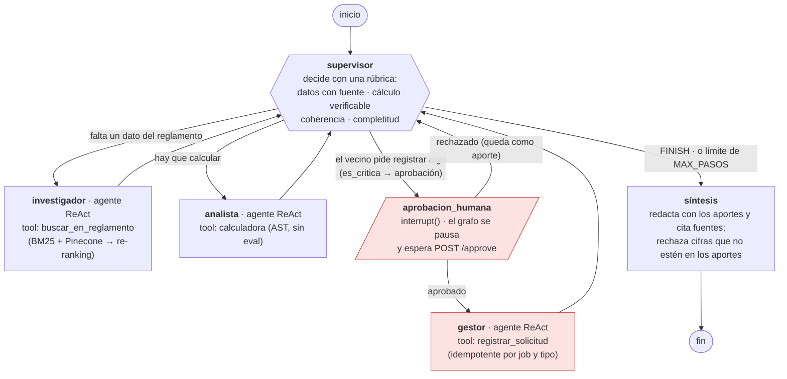
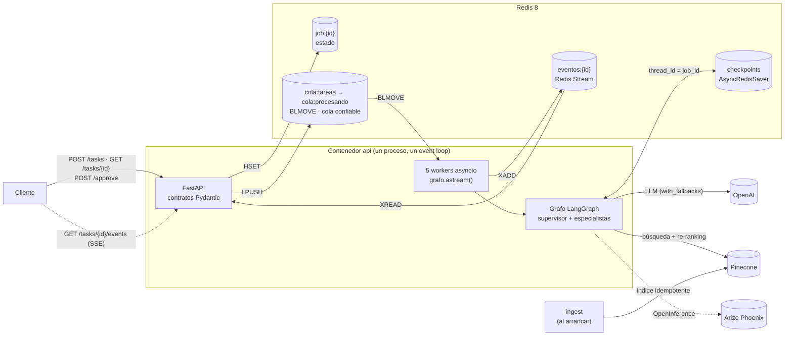
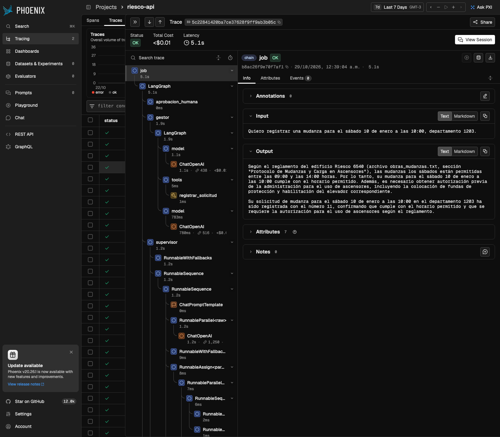

# Orquestador multi-agente del Edificio Riesco 6540

Proyecto final del curso AI Engineering de Coderhouse (2026).

En un edificio nuevo, las mismas preguntas se repiten todas las semanas: a qué hora se puede hacer
una mudanza, si se permiten mascotas, cuánto es la multa por ruidos molestos. Las respuestas están en
el reglamento de copropiedad, pero casi nadie lo lee completo. Este sistema contesta esas preguntas
citando la sección del reglamento de donde sale cada dato, hace los cálculos cuando hacen falta y,
si un vecino pide registrar algo, deja la solicitud en espera hasta que una persona de la
administración la apruebe.

Por dentro, un supervisor reparte el trabajo entre tres agentes: un investigador que busca en el
reglamento (búsqueda híbrida con re-ranking), un analista que calcula y un gestor que registra
solicitudes. Todo corre detrás de una API asíncrona, con el estado guardado en Redis y cada ejecución
trazada en Arize Phoenix.

Así se resuelve una pregunta que necesita buscar y calcular:

```text
"Si hago ruidos molestos después de las 22:00 tres veces este mes, ¿cuánto pagaría de multa?"
  supervisor → investigador (busca la norma, con fuente) → supervisor → analista (calcula 2 + 4 + 4)
  → supervisor → síntesis: "10 UTM: la primera infracción son 2 UTM y la reincidencia se duplica…
     Fuente: convivencia_privada.txt, sección Procedimiento Sancionatorio y Régimen de Multas."
```

Contenido: [Inicio rápido](#inicio-rápido), [Uso de la API](#uso-de-la-api),
[El grafo de agentes](#el-grafo-de-agentes), [Arquitectura](#arquitectura),
[Requisitos de la entrega](#cómo-se-cumple-cada-requisito), [Evidencia](#evidencia),
[Decisiones de arquitectura](#decisiones-de-arquitectura), [Desarrollo](#desarrollo),
[Lo que aprendí](#lo-que-aprendí), [Limitaciones](#limitaciones-conocidas).

---

## Inicio rápido

Necesitas Docker con Compose v2 y claves de [OpenAI](https://platform.openai.com/api-keys) y
[Pinecone](https://app.pinecone.io) (el plan gratuito de Pinecone alcanza). No hay que instalar
Python ni cargar nada a mano: el arranque crea el índice vectorial y sube el reglamento.

```bash
git clone https://github.com/AppArtCL/ai_eng_final.git
cd ai_eng_final
cp .env.example .env          # completa OPENAI_API_KEY y PINECONE_API_KEY
./run.sh                      # o: docker compose up --build
```

`run.sh` revisa que Docker esté corriendo y que el `.env` tenga las claves, levanta los servicios y
espera a que estén sanos. Arrancan en este orden:

1. Redis (estado, cola y checkpoints) y Phoenix (trazas).
2. `ingest`, que crea el índice de Pinecone si no existe y sube el reglamento si no está al día. En
   los arranques siguientes solo verifica y termina en segundos. Si falla, la API no arranca.
3. La API, en http://localhost:8000, con 5 workers.

Con todo arriba, la documentación interactiva de la API queda en http://localhost:8000/docs y las
trazas, con costo y latencia, en http://localhost:6006. Para apagar basta con `docker compose down`;
los datos se conservan en volúmenes.

---

## Uso de la API

| Método y ruta | Qué hace |
|---|---|
| `POST /tasks` | Encola una pregunta o solicitud. Responde 202 con el `job_id` en milisegundos, sin esperar al LLM |
| `GET /tasks/{job_id}` | Estado: `PENDING` → `RUNNING` → `DONE` / `FAILED`, o `WAITING_APPROVAL` |
| `GET /tasks/{job_id}/events` | Progreso en vivo (SSE): estados, nodos que terminan y tokens de la respuesta |
| `POST /tasks/{job_id}/approve` | Aprueba o rechaza una acción pendiente (`{"aprobado": bool, "comentario": str}`) |
| `GET /health` | Verifica que la API llega a Redis |

### Una pregunta, siguiendo el progreso en vivo

```bash
JOB=$(curl -s -X POST localhost:8000/tasks -H 'Content-Type: application/json' \
  -d '{"pregunta":"¿Puedo hacer asados en mi terraza?"}' | jq -r .job_id)

curl -N localhost:8000/tasks/$JOB/events
# event: estado  data: {"status": "RUNNING"}
# event: nodo    data: {"nodo": "supervisor"}
# event: nodo    data: {"nodo": "investigador"}
# event: token   data: {"texto": "No"}   ← la respuesta llega token a token
# …
# event: estado  data: {"status": "DONE", "respuesta": "…"}
```

### Una acción que requiere aprobación humana

```bash
JOB=$(curl -s -X POST localhost:8000/tasks -H 'Content-Type: application/json' \
  -d '{"pregunta":"Quiero registrar una mudanza para el sábado 10 de enero a las 10:00, depto 1203."}' | jq -r .job_id)

curl -s localhost:8000/tasks/$JOB | jq '{status, aprobacion_pendiente}'
# "status": "WAITING_APPROVAL",
# "aprobacion_pendiente": {"accion": "Registra una solicitud de mudanza…", "razon": "…", "pregunta": "…"}

curl -s -X POST localhost:8000/tasks/$JOB/approve -H 'Content-Type: application/json' \
  -d '{"aprobado": true, "comentario": "Visto bueno de la administración"}'
# o, para rechazar: {"aprobado": false, "comentario": "Ese sábado hay mantención de ascensores"}
```

Si se intenta aprobar dos veces el mismo job, la API responde 409. Un `job_id` con formato inválido
da 422, uno que no existe da 404 y, con Redis caído, 503. Todo está documentado en `/docs`.

---

## El grafo de agentes



Algunas decisiones del diseño que no se ven a simple vista en el diagrama:

- Los especialistas siempre vuelven al supervisor. Si un aporte no cumple la rúbrica, el supervisor
  puede devolverlo con una instrucción de corrección.
- Cada especialista recibe solo la instrucción del supervisor, no la conversación completa. Así
  trabaja con un contexto corto y una tarea acotada.
- Que una acción sea crítica lo decide el código (`es_critica`), no el modelo. El gestor no tiene
  arista directa desde el supervisor: la única forma de llegar a él es pasando por la aprobación
  humana.
- Hay controles que no dependen del LLM: `MAX_PASOS` corta los ciclos, la síntesis rechaza cualquier
  número que no aparezca en los aportes y el número de solicitud sale del registro real, no del modelo.

El dibujo de arriba está hecho a mano para que se entienda. Para comprobar que coincide con el grafo
que realmente se compila, en [`docs/diagrama-grafo.png`](docs/diagrama-grafo.png) está el diagrama
generado desde el código (se regenera con `uv run python -m app.graph.builder`).

---

## Arquitectura



La API nunca ejecuta el grafo: registra el job, lo deja en la cola y responde. Los workers, que
corren en el mismo proceso, toman los jobs de la cola y publican el avance en un stream de Redis, que
es lo que la API le transmite al cliente por SSE.

| Capa | Dónde | Responsabilidad |
|---|---|---|
| Configuración | [`app/config.py`](app/config.py) | `Settings` con `pydantic-settings`: todo por variables de entorno, validado al arrancar |
| API | [`app/api/`](app/api/) | Endpoints async y contratos (`schemas.py`) |
| Cola y workers | [`app/queue/`](app/queue/) | Jobs, cola confiable con recuperación de huérfanos, eventos SSE y el worker |
| Grafo | [`app/graph/`](app/graph/) | Estado, construcción con `AsyncRedisSaver` y reintentos por nodo, aprobación humana |
| Agentes | [`app/agents/`](app/agents/) | Supervisor y síntesis, los 3 especialistas, sus herramientas y contratos |
| Cadenas | [`app/chains/`](app/chains/) | LCEL del M2: salida estructurada validada, `with_retry` y `with_fallbacks` |
| RAG | [`app/rag/`](app/rag/) | Fragmentación, BM25 + Pinecone, re-ranking, preparación del índice y evaluación |
| Observabilidad | [`app/observability/`](app/observability/) | Phoenix + OpenInference |

### Persistencia y recuperación

Un job sobrevive a un reinicio de la API sin importar en qué estado esté
([ADR 0004](docs/adr/0004-cola-confiable-y-recuperacion.md)):

| Estado al reiniciar | Qué pasa al arrancar |
|---|---|
| `PENDING` | El mensaje sigue en `cola:tareas` y un worker lo toma |
| `WAITING_APPROVAL` | El checkpoint guarda el `interrupt()`: se aprueba después y se reanuda en el proceso nuevo |
| `RUNNING` | El mensaje quedó en `cola:procesando`, vuelve a la cola y el grafo continúa desde su último checkpoint (`ainvoke(None)`), sin repetir los nodos que ya terminaron |

El escenario 5 de las pruebas de punta a punta lo comprueba en cada corrida, matando la API con un
`SIGKILL` a mitad de una ejecución.

### Resiliencia

Todas las capas usan el mismo criterio para decidir qué error es transitorio y vale la pena
reintentar ([ADR 0007](docs/adr/0007-resiliencia-por-capas-e-idempotencia.md)). El cliente del LLM
reintenta; las cadenas reintentan si el modelo devuelve una salida inválida y pasan a un modelo de
respaldo si el principal falla; las herramientas le devuelven el error al agente en vez de botar el
grafo; cada nodo tiene su `RetryPolicy` y cada job, un tope de tiempo. El único efecto lateral del
sistema, registrar una solicitud, es idempotente: aunque se reintente, queda registrada una sola vez.

---

## Cómo se cumple cada requisito

Cada requisito del enunciado, con el lugar donde se puede verificar:

| Requisito de la entrega | Cómo y dónde |
|---|---|
| RAG (híbrido, metadatos, re-ranking) | BM25 + Pinecone (RRF) → cross-encoder `bge-reranker-v2-m3`; cada fragmento lleva fuente, sección y relevancia. [`app/rag/`](app/rag/) · [ADR 0005](docs/adr/0005-rag-hibrido-con-reranking.md) |
| El RAG como tool del investigador | `buscar_en_reglamento` con `args_schema` y artefacto `ResultadoBusqueda`. [`app/agents/tools.py`](app/agents/tools.py) |
| Supervisor que delega y corrige | Rúbrica de validación, reenvío con instrucción de corrección, autocorrección de argumentos inválidos. [ADR 0001](docs/adr/0001-supervisor-con-especialistas.md) |
| Cadenas LCEL con contratos y resiliencia (M2) | `prompt \| llm.with_structured_output(include_raw=True) \| validar`, `with_retry`, `with_fallbacks`. [`app/chains/`](app/chains/) |
| Cliente async y streaming (M1) | `ainvoke` de punta a punta; tokens de la respuesta por SSE; `timeout` por llamada y por job. [ADR 0010](docs/adr/0010-streaming-sse-via-redis-streams.md) |
| Todo async (sin bloqueos ocultos) | Nodos `async def`, `redis.asyncio`, Pinecone async. Medido: `/health` p50 ≈ 3,5 ms con 5 jobs concurrentes. [ADR 0002](docs/adr/0002-api-asincrona-con-cola-en-redis.md) |
| Checkpointer persistente | `AsyncRedisSaver`, `thread_id = job_id`; sobrevive a reinicios (probado con `SIGKILL`). [ADR 0003](docs/adr/0003-redis-como-estado-cola-y-checkpointer.md) |
| Pydantic en la API y en las tools | Entradas, salidas y errores de la API; `args_schema` y artefactos validados en las tools; estado validado. [ADR 0006](docs/adr/0006-contratos-pydantic-en-las-fronteras.md) |
| API documentada | FastAPI con OpenAPI completo (tags, ejemplos, 202/404/409/422/503) en `/docs` |
| Trazas en Phoenix con árbol y costo | OpenInference; span raíz por job con `session.id`; costo y desglose por nodo. [ADR 0009](docs/adr/0009-observabilidad-con-phoenix.md) |
| Al menos 5 pruebas con capturas | [`docs/evidencia/pruebas-e2e.md`](docs/evidencia/pruebas-e2e.md) y [`docs/evidencia/capturas/`](docs/evidencia/capturas/) |
| Un solo comando, máquina limpia | `./run.sh` o `docker compose up`, con ingesta automática e idempotente del índice |
| Python 3.12, dependencias, variables de entorno | `.python-version`, `pyproject.toml` + `uv.lock` (versiones exactas), [`.env.example`](.env.example) sin valores fijos en el código |
| Sin secretos | `.env` ignorado por git; `SecretStr` evita que las claves aparezcan en logs |

---

## Evidencia

### Pruebas de punta a punta

`uv run python scripts/e2e.py` corre 5 escenarios contra el stack real, con OpenAI y Pinecone de
verdad. Sigue cada uno en vivo por SSE, verifica que haya pasado por los nodos esperados y consulta
en Phoenix su costo y latencia. Las respuestas completas y las capturas del árbol de spans están en
[`docs/evidencia/pruebas-e2e.md`](docs/evidencia/pruebas-e2e.md).

| # | Escenario | Qué demuestra | Nodos | Costo (USD) |
|---|---|---|---|---|
| 1 | Consulta normativa | RAG con re-ranking, citas y streaming | supervisor → investigador → supervisor → síntesis | 0,0028 |
| 2 | Cálculo de varios pasos | Delegación investigador → analista | … → investigador → … → analista → … → síntesis | 0,0043 |
| 3 | Aprobación humana aceptada | `interrupt()`, aprobación y registro idempotente (2 trazas: pausa y reanudación) | … → aprobacion_humana → gestor → … → síntesis | 0,0038 |
| 4 | Aprobación humana rechazada | El gestor no se ejecuta y la respuesta explica el motivo | … → aprobacion_humana → supervisor → síntesis | 0,0026 |
| 5 | Reinicio a mitad | `SIGKILL` → el job se retoma desde el checkpoint y el SSE se reconecta con `Last-Event-ID` | … → analista → … → síntesis | 0,0036 |



### Dónde se va el costo y la latencia

| Nodo | Ejecuciones | Latencia promedio | % del costo |
|---|---|---|---|
| supervisor | 13 | 1,4 s | 42 % |
| investigador | 5 | 4,4 s | 25 % |
| síntesis | 5 | 2,5 s | 21 % |
| analista | 2 | 2,9 s | 10 % |
| gestor | 1 | 2,0 s | 3 % |

El supervisor es el nodo más caro: corre unas 2,6 veces por pregunta y su contexto crece con cada
aporte. El investigador es el más lento, porque busca, reordena los resultados y llama dos veces al
LLM. Si tuviera que optimizar, partiría por ahí: un modelo más chico solo para decidir la ruta, y
resumir los aportes en vez de pasárselos completos al supervisor. Una pregunta típica cuesta entre
USD 0,002 y 0,004.

### Cuánto mejora el re-ranking

Evalué la búsqueda con 18 preguntas cuya sección correcta del reglamento conozco de antemano
([reporte](docs/evidencia/evaluacion-rag.md), `uv run python -m app.rag.evaluate`):

| Sistema | Acierto@1 | MRR | Recall@5 |
|---|---|---|---|
| Híbrido (BM25 + Pinecone, RRF) | 72 % | 0,85 | 100 % |
| Híbrido + re-ranking | 94 % | 0,97 | 100 % |

Con el re-ranking, la sección correcta queda en primer lugar en 17 de las 18 preguntas, contra 13 sin
él. No todo mejoró: en una pregunta (la 8) bajó del primer al segundo lugar. El detalle por pregunta
está en el reporte.

### Concurrencia

`uv run python scripts/carga.py` lanza 5 preguntas a la vez y, mientras corren, consulta
`GET /health` cada 100 ms. La mediana de respuesta es de 3,5 ms y el p95, de 5 ms. Como `/health`
comparte el event loop con los workers, cualquier llamada bloqueante escondida se notaría de
inmediato en esos tiempos.

---

## Decisiones de arquitectura

Las decisiones de diseño importantes están escritas como ADR en [`docs/adr/`](docs/adr/). Cada una
explica el contexto, qué se decidió, qué alternativas se descartaron y por qué, y qué evidencia la
respalda.

| # | Decisión |
|---|---|
| [0001](docs/adr/0001-supervisor-con-especialistas.md) | Supervisor con especialistas en LangGraph |
| [0002](docs/adr/0002-api-asincrona-con-cola-en-redis.md) | API asíncrona con cola en Redis y workers en el mismo proceso |
| [0003](docs/adr/0003-redis-como-estado-cola-y-checkpointer.md) | Redis como estado, cola, eventos y checkpointer |
| [0004](docs/adr/0004-cola-confiable-y-recuperacion.md) | Cola confiable y recuperación de jobs interrumpidos |
| [0005](docs/adr/0005-rag-hibrido-con-reranking.md) | RAG híbrido con re-ranking hospedado en Pinecone |
| [0006](docs/adr/0006-contratos-pydantic-en-las-fronteras.md) | Contratos Pydantic en cada frontera |
| [0007](docs/adr/0007-resiliencia-por-capas-e-idempotencia.md) | Resiliencia por capas e idempotencia |
| [0008](docs/adr/0008-aprobacion-humana-con-interrupt.md) | Aprobación humana con `interrupt()` |
| [0009](docs/adr/0009-observabilidad-con-phoenix.md) | Observabilidad con Arize Phoenix |
| [0010](docs/adr/0010-streaming-sse-via-redis-streams.md) | Progreso en vivo con SSE y Redis Streams |

---

## Desarrollo

Para trabajar fuera de Docker se necesita Python 3.12 y [uv](https://docs.astral.sh/uv/):

```bash
uv sync                                   # dependencias exactas desde uv.lock
docker compose up -d redis phoenix        # Redis y Phoenix siguen en Docker
uv run python -m app.rag.preparar         # índice de Pinecone (lo mismo que hace el servicio ingest)
uv run uvicorn app.api.main:app --port 8000
```

| Comando | Qué hace |
|---|---|
| `uv run pytest -q` | 128 tests que no llaman al LLM (nodos falsos, `fakeredis`). Los 2 marcados `redis` usan un Redis real y se saltan si no hay uno levantado |
| `uv run python scripts/e2e.py` | Las 5 pruebas de punta a punta con evidencia (unos 2 minutos y USD 0,02; necesita el stack arriba) |
| `uv run python -m app.rag.evaluate` | Evaluación del re-ranking con las 18 preguntas |
| `uv run python scripts/carga.py` | Prueba de concurrencia (`--con-hitl` suma una aprobación) |
| `uv run python -m app.graph.builder` | Regenera el diagrama del grafo desde el código |

La configuración completa, con valores por defecto y comentarios, está en
[`.env.example`](.env.example). Solo `OPENAI_API_KEY` y `PINECONE_API_KEY` son obligatorias.

### Estructura

```text
app/
├── config.py          configuración validada (pydantic-settings)
├── api/               FastAPI: endpoints y contratos
├── queue/             jobs, cola confiable, eventos SSE y workers
├── graph/             estado, construcción del grafo y aprobación humana
├── agents/            supervisor, síntesis, especialistas, herramientas y sus contratos
├── chains/            cadenas LCEL con validación, reintentos y respaldo
├── rag/               fragmentación, recuperación híbrida, re-ranking, preparación y evaluación
│   └── data/          el reglamento (4 documentos)
└── observability/     Phoenix + OpenInference
tests/                 128 tests
scripts/               pruebas de punta a punta y de carga
docs/                  ADRs, diagrama del grafo y evidencia (reportes y capturas)
```

---

## Lo que aprendí

Los problemas que más me enseñaron no aparecieron en los tests unitarios, sino al correr el sistema
de verdad:

- **La concurrencia destapa bugs que un job solo no muestra.** Con un job a la vez todo funcionaba.
  Con cinco, 3 fallaban con `Session is closed`: `langchain-pinecone` cerraba su sesión HTTP
  compartida al terminar cada búsqueda. La solución fue abrir esa sesión una sola vez, al arrancar la
  API.
- **Lo que vuelve de un checkpoint no es lo mismo que se guardó.** Al retomar un job desde Redis, los
  artefactos de las herramientas volvían como diccionarios y no como objetos Pydantic, y el gestor
  informaba que no se había registrado nada cuando sí se había registrado. Ahora el artefacto se
  vuelve a validar con su modelo.
- **Un `SIGKILL` también se lleva las trazas pendientes.** Phoenix recibe los spans por lotes, así
  que la traza de una ejecución que muere de golpe nunca llega. La prueba de reinicio espera a que
  salga el lote antes de matar el proceso.
- **En un stream SSE ya no se puede responder 404.** Cuando el generador empieza, la respuesta ya
  salió con 200. La validación de que el job existe tuvo que pasar a una dependencia de FastAPI; lo
  detectó un test.

Cada uno de estos casos tiene hoy un test de regresión o una prueba de punta a punta que lo cubre.

---

## Limitaciones conocidas

- Una sola instancia de la API. Al arrancar, todo lo que hay en `cola:procesando` se considera
  huérfano; con varias réplicas habría que identificar qué instancia tomó cada mensaje (ADR 0004).
- Sin autenticación. Cualquiera que llegue al puerto puede aprobar una acción; en producción,
  `/approve` debería exigir un rol de administración.
- Una solicitud por tipo y job, porque la idempotencia del gestor usa `(job_id, tipo)` (ADR 0007).
- Los tokens del SSE son un borrador. Si la validación de cifras pide reescribir la respuesta, la
  definitiva es la del evento `DONE`.
- Una ejecución que muere con `SIGKILL` no deja su traza en Phoenix (se exporta por lotes). La
  ejecución retomada sí queda trazada, marcada con `job.retomado`.
- `langchain-community` está en retiro. `BM25Retriever` todavía vive en ese paquete, que emite un
  `DeprecationWarning` en los tests; cuando exista un paquete independiente para BM25, se migra el
  import de `app/rag/retrievers.py`.
- El re-ranking usa la cuota de inference del plan de Pinecone. Si se agota, el sistema sigue
  funcionando con la búsqueda híbrida, sin re-ranking.

---

## Origen de cada pieza

El proyecto junta lo que construí en los módulos del curso, pasado a async:

| Módulo | Pieza en este repositorio |
|---|---|
| M1 · Cimientos asíncronos | Cliente del LLM con timeout, reintentos y modelo de respaldo (`get_llm` en [`app/config.py`](app/config.py)); streaming de tokens con `astream` (`ejecutar_grafo` en [`app/queue/worker.py`](app/queue/worker.py)) |
| M2 · Orquestación declarativa | Cadenas LCEL con contrato Pydantic, `include_raw` y `with_retry` ([`app/chains/`](app/chains/)) |
| M3–M4 · RAG avanzado | Fragmentación por secciones, BM25 en español + Pinecone, ahora con re-ranking y evaluación |
| M5–M6 · Agentes | Grafo con supervisor y especialistas, rúbrica de validación |
| M7 · Producción | FastAPI, Redis, `AsyncRedisSaver`, aprobación humana y Phoenix. El código parte de [AppArtCL/ai_eng_m7](https://github.com/AppArtCL/ai_eng_m7), que conserva el historial de las pre-entregas |
