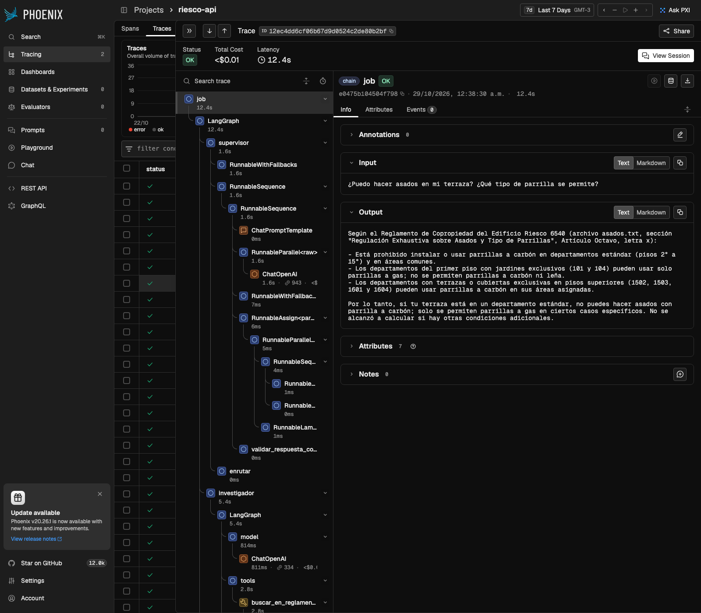
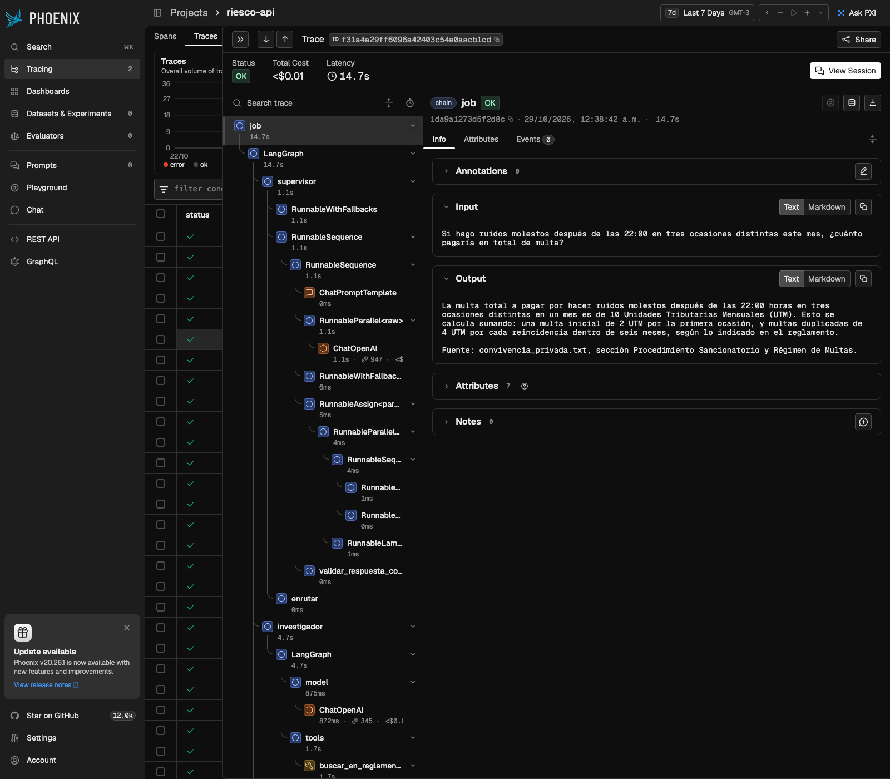
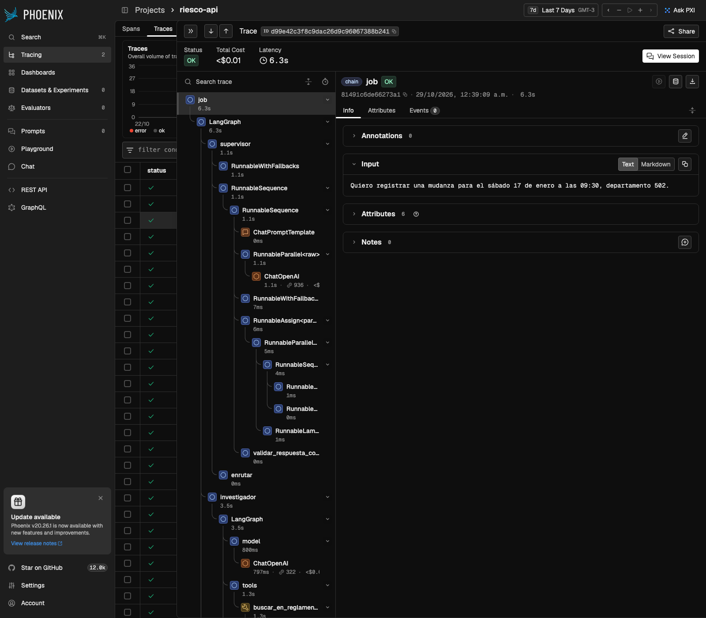
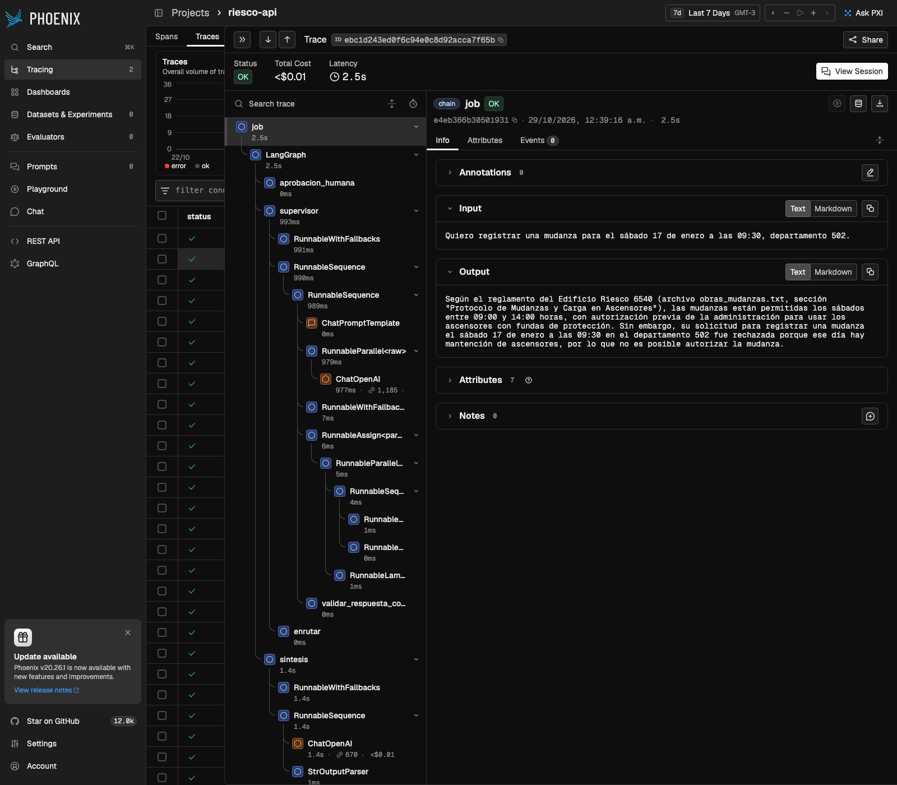
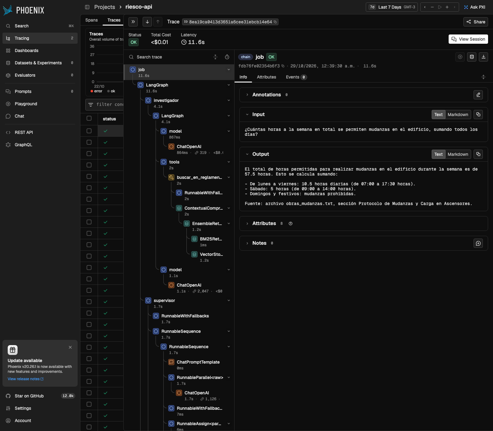

# Pruebas de punta a punta con trazas

Corrida del 29-10-2026 00:38 con `uv run python scripts/e2e.py` contra `docker compose up` (API + Redis + Phoenix, OpenAI y Pinecone reales). Cada escenario se siguió en vivo por SSE; costo, latencia y desglose por nodo salen de la API GraphQL de Phoenix.

| # | Escenario | Qué prueba | Estado | Nodos (en orden) | Trazas | Latencia | Tokens | Costo (USD) |
|---|---|---|---|---|---|---|---|---|
| 1 | `consulta-normativa` | RAG híbrido + re-ranking, citas de la fuente y streaming de la respuesta | ✅ DONE | supervisor → investigador → supervisor → sintesis | 1 | 12.5 s | 6,200 | 0.0028 |
| 2 | `calculo-multipaso` | Delegación investigador → analista: el supervisor no calcula, el analista usa la calculadora | ✅ DONE | supervisor → investigador → supervisor → analista → supervisor → sintesis | 1 | 14.8 s | 9,497 | 0.0043 |
| 3 | `hitl-aprobado` | Acción con efectos reales: pausa con interrupt(), aprobación humana y registro idempotente | ✅ DONE | supervisor → investigador → supervisor → aprobacion_humana → gestor → supervisor → sintesis | 2 | 12.3 s | 7,454 | 0.0038 |
| 4 | `hitl-rechazado` | Rechazo humano: el gestor no se ejecuta y la respuesta explica el motivo | ✅ DONE | supervisor → investigador → supervisor → aprobacion_humana → supervisor → sintesis | 2 | 8.8 s | 6,304 | 0.0026 |
| 5 | `reinicio-a-mitad` | Persistencia: SIGKILL a la API a mitad del grafo; el job se retoma desde su checkpoint en Redis | ✅ DONE | supervisor → supervisor → investigador → supervisor → analista → supervisor → sintesis | 1 | 11.7 s | 7,221 | 0.0036 |

**Costo total de la corrida: USD 0.0171.**

## Costo y latencia por nodo (todas las pruebas)

| Nodo | Ejecuciones | Latencia promedio | Latencia total | Tokens | Costo (USD) | % del costo |
|---|---|---|---|---|---|---|
| supervisor | 13 | 1.4 s | 17.7 s | 14,651 | 0.0071 | 42% |
| investigador | 5 | 4.4 s | 21.9 s | 12,265 | 0.0042 | 25% |
| sintesis | 5 | 2.5 s | 12.5 s | 5,657 | 0.0035 | 21% |
| analista | 2 | 2.9 s | 5.8 s | 3,149 | 0.0017 | 10% |
| gestor | 1 | 2.0 s | 2.0 s | 954 | 0.0005 | 3% |
| aprobacion_humana | 4 | 0.0 s | 0.0 s | 0 | 0.0000 | 0% |

## Detalle por escenario

### 1. `consulta-normativa`

**Pregunta:** ¿Puedo hacer asados en mi terraza? ¿Qué tipo de parrilla se permite?

`job_id`: `4e25d3269d224b8c927a24390e0d9768` · duración vista por el cliente: 12.5 s · tokens recibidos por SSE: 391 · reconexiones SSE: 1

Verificaciones: ✅ terminó en DONE · ✅ recibió tokens por SSE · ✅ pasó por supervisor · ✅ pasó por investigador · ✅ pasó por sintesis · ✅ no pasó por gestor · ✅ Phoenix registró sus 1 traza(s)

- Traza `12ec4dd6cf06b67d9d0524c2de80b2bf` (inicio): 12.47 s, 6,200 tokens, USD 0.0028

> Según el Reglamento de Copropiedad del Edificio Riesco 6540 (archivo asados.txt, sección "Regulación Exhaustiva sobre Asados y Tipo de Parrillas", Artículo Octavo, letra x):  - Está prohibido instalar o usar parrillas a carbón en departamentos estándar (pisos 2° a 15°) y en áreas comunes. - Los departamentos del primer piso con jardines exclusivos (101 y 104) pueden usar solo parrillas a gas; no se permiten parrillas a carbón ni leña. - Los departamentos con terrazas o cubiertas exclusivas en pisos superiores (1502, 1503, 1601 y 1604) pueden usar parrillas a carbón en sus áreas asignadas.  Por…

### 2. `calculo-multipaso`

**Pregunta:** Si hago ruidos molestos después de las 22:00 en tres ocasiones distintas este mes, ¿cuánto pagaría en total de multa?

`job_id`: `8d34e8be363b43f0908beed3a0b5e502` · duración vista por el cliente: 14.8 s · tokens recibidos por SSE: 255

Verificaciones: ✅ terminó en DONE · ✅ recibió tokens por SSE · ✅ pasó por investigador · ✅ pasó por analista · ✅ pasó por sintesis · ✅ Phoenix registró sus 1 traza(s)

- Traza `f31a4a29ff6096a42403c54a0aacb1cd` (inicio): 14.77 s, 9,497 tokens, USD 0.0043

> La multa total a pagar por hacer ruidos molestos después de las 22:00 horas en tres ocasiones distintas en un mes es de 10 Unidades Tributarias Mensuales (UTM). Esto se calcula sumando: una multa inicial de 2 UTM por la primera ocasión, y multas duplicadas de 4 UTM por cada reincidencia dentro de seis meses, según lo indicado en el reglamento.  Fuente: convivencia_privada.txt, sección Procedimiento Sancionatorio y Régimen de Multas.

### 3. `hitl-aprobado`

**Pregunta:** Quiero registrar una mudanza para el sábado 10 de enero a las 10:00, departamento 1203.

`job_id`: `907955e339154497b6e5c5246bea600a` · duración vista por el cliente: 12.3 s · tokens recibidos por SSE: 179

Verificaciones: ✅ terminó en DONE · ✅ recibió tokens por SSE · ✅ pasó por aprobacion_humana · ✅ pasó por gestor · ✅ pasó por sintesis · ✅ Phoenix registró sus 2 traza(s)

- Traza `c2b11d80bcf3bd01f0df8f7280d948e4` (inicio): 7.18 s, 4,482 tokens, USD 0.0022
- Traza `5c22841420ba7ce37628f9ff9ab3b05c` (reanudación tras aprobar): 5.14 s, 2,972 tokens, USD 0.0016

> Según el reglamento del edificio Riesco 6540 (archivo obras_mudanzas.txt, sección "Protocolo de Mudanzas y Carga en Ascensores"), las mudanzas los sábados están permitidas entre las 09:00 y las 14:00 horas. Por lo tanto, su mudanza para el sábado 10 de enero a las 10:00 cumple con el horario permitido. Además, es necesario obtener autorización previa de la administración para el uso de ascensores, incluyendo la colocación de fundas de protección y habilitación del elevador correspondiente.  Su solicitud de mudanza para el sábado 10 de enero a las 10:00 en el departamento 1203 ha sido registrad…

### 4. `hitl-rechazado`

**Pregunta:** Quiero registrar una mudanza para el sábado 17 de enero a las 09:30, departamento 502.

`job_id`: `5ae7038d3f7e4f2b8e88ed4c172314b5` · duración vista por el cliente: 8.8 s · tokens recibidos por SSE: 129

Verificaciones: ✅ terminó en DONE · ✅ recibió tokens por SSE · ✅ pasó por aprobacion_humana · ✅ pasó por sintesis · ✅ no pasó por gestor · ✅ Phoenix registró sus 2 traza(s)

- Traza `d99e42c3f8c9dac26d9c96067388b241` (inicio): 6.32 s, 4,449 tokens, USD 0.0017
- Traza `ebc1d243ed0f6c94e0c8d92acca7f65b` (reanudación tras aprobar): 2.51 s, 1,855 tokens, USD 0.0010

> Según el reglamento del Edificio Riesco 6540 (archivo obras_mudanzas.txt, sección "Protocolo de Mudanzas y Carga en Ascensores"), las mudanzas están permitidas los sábados entre 09:00 y 14:00 horas, con autorización previa de la administración para usar los ascensores con fundas de protección. Sin embargo, su solicitud para registrar una mudanza el sábado 17 de enero a las 09:30 en el departamento 502 fue rechazada porque ese día hay mantención de ascensores, por lo que no es posible autorizar la mudanza.

### 5. `reinicio-a-mitad`

**Pregunta:** ¿Cuántas horas a la semana en total se permiten mudanzas en el edificio, sumando todos los días?

`job_id`: `b0ee8e02059f4f81820ae25851dd5931` · duración vista por el cliente: 15.3 s · tokens recibidos por SSE: 113 · reconexiones SSE: 1

Verificaciones: ✅ terminó en DONE · ✅ recibió tokens por SSE · ✅ pasó por investigador · ✅ pasó por sintesis · ✅ el stream se cortó y se reanudó con Last-Event-ID · ✅ Phoenix registró sus 1 traza(s) · ✅ la traza quedó marcada job.retomado

- Traza `8ea19ca0413d3651a6cee31ebcb14e64` (inicio, retomada desde el checkpoint tras el reinicio): 11.67 s, 7,221 tokens, USD 0.0036

> El total de horas permitidas para realizar mudanzas en el edificio durante la semana es de 57.5 horas. Esto se calcula sumando:  - De lunes a viernes: 10.5 horas diarias (de 07:00 a 17:30 horas). - Sábado: 5 horas (de 09:00 a 14:00 horas). - Domingos y festivos: mudanzas prohibidas.  Fuente: archivo obras_mudanzas.txt, sección Protocolo de Mudanzas y Carga en Ascensores.
